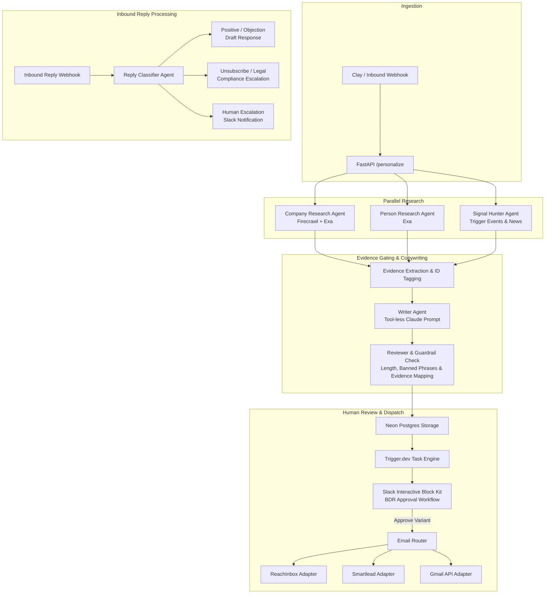

# AI SDR Engine

An end-to-end multi-agent outbound system built for modern go-to-market teams. Built by Joe Deville.

This repository demonstrates a production-grade architecture that moves outbound prospecting from manual research to personalized, evidence-grounded outreach. It combines parallel research agents, a tool-less writer that prevents hallucinations, interactive Slack human-in-the-loop review, automated multi-channel sending, and webhook-driven reply classification.

## Overview

Traditional outbound automation relies on rigid mail merges or unconstrained LLMs that make up facts about prospects. This engine solves both problems through strict separation of responsibilities:

1. Inbound Prospect Ingestion: Receives enriched prospect and account data from Clay via webhook or REST API.
2. Parallel Research Agents: Three subagents (Company Researcher, Person Researcher, Signal Hunter) execute in parallel using Firecrawl and Exa to gather verified public signals.
3. Evidence Merging and Gating: Extracted facts are assigned unique evidence identifiers (such as ev_001). The Writer agent operates without web browsing tools, forcing it to generate copy using only cited evidence.
4. Guardrails and Deterministic Review: A reviewer agent and rule-based validation enforce word limits, ban corporate buzzwords, and ensure every factual statement maps back to an evidence record.
5. Slack Human Approval: Generates draft variants with predicted reply scores and key risks. BDRs review and approve copy directly in Slack via Block Kit buttons before anything leaves the system.
6. Multi-Channel Dispatch: Routes approved messages through ReachInbox, Smartlead, or Gmail API based on account tier.
7. Reply Handling: Inbound email replies trigger a Claude classifier that tags intent (positive, objection, out of office, unsubscribe, wrong person, or human escalation) and notifies reps in Slack.
8. Background Orchestration: Trigger.dev handles distributed background jobs with Neon Postgres persistence, alongside a lightweight FastAPI personalizer with SQLite trace logging.

## Architecture



## System Components

### 1. Personalization Service (Python / FastAPI)
Located in `app/`. Provides a synchronous endpoint for Clay or any webhook source. Uses in-process research agents to assemble evidence and write 3-step outbound sequences.
- `app/orchestrator.py`: Orchestrates parallel research fan-out, evidence deduplication, drafting, and review passes.
- `app/agents/`: Subagents for company profiling, person research, trigger hunting, copy generation, and editorial review.
- `app/guardrails.py`: Deterministic checks for word counts, banned phrases, and evidence verification.
- `app/viewer.py`: HTML trace visualizer mounted at `/traces` to inspect drafts with highlighted evidence citations.

### 2. Execution Pipeline (TypeScript / Trigger.dev)
Located in `pipeline/`. Provides background task execution, database persistence, Slack approvals, and email dispatch.
- `pipeline/automations/src/ai-sdr-research.ts`: Trigger.dev task for account research and holdout splitting.
- `pipeline/automations/src/ai-sdr-write.ts`: Generates variants anchored to specific value propositions.
- `pipeline/automations/src/ai-sdr-score.ts`: Evaluates drafts for predicted response quality and risk factors.
- `pipeline/automations/src/ai-sdr-send.ts`: Dispatches approved drafts through the appropriate sending provider.
- `pipeline/automations/src/ai-sdr-reply.ts`: Classifies inbound responses and coordinates follow-ups.
- `pipeline/automations/src/ai-sdr/lib/slack.ts`: Slack Block Kit builder for rep approvals.
- `pipeline/schema.sql`: Neon Postgres DDL tracking briefs, drafts, scores, sends, and replies.

## Core Technical Principles

### Tool-Less Writer Pattern
The writer agent is deliberately denied web tools and browsing capabilities. It only receives structured JSON containing verified evidence strings tagged with IDs. If a claim does not exist in the evidence payload, the model cannot make it. This eliminates hallucinated customer facts.

### Deterministic Quality Gates
Every draft must pass strict programmatic filters before reaching human review:
- Email 1: 90 words maximum, subject line 55 characters maximum.
- Email 2: 60 words maximum.
- Email 3: 40 words maximum.
- Explicitly banned phrase filters to remove generic sales jargon.
- Evidence mapping: Each factual claim must correlate to an evidence ID.

### Rep in the Loop
No message is sent automatically without verification. Sales development reps see the exact signal observed, three distinct angles (variant A, B, and C), the predicted reply likelihood, and primary risk factors directly in Slack. A single click approves and sends the message.

## How to Run with Sample Data

### Prerequisites
- Python 3.11 or higher
- Node.js 18 or higher with npm

### 1. Run the Python Personalization Service

Set up the Python environment:
```bash
python3 -m venv .venv
source .venv/bin/activate
pip install -e ".[dev]"
```

Configure environment settings:
```bash
cp .env.example .env
```

`DRY_RUN=1` is enabled by default in `.env.example`. In dry run mode, tool calls return local mock fixtures so you can test the full pipeline without external API keys.

Run the test suite:
```bash
pytest -v
```

Start the FastAPI application:
```bash
uvicorn app.main:app --reload --port 8000
```

Send the provided sample Clay payload in a separate terminal:
```bash
curl -X POST http://localhost:8000/personalize \
  -H "Content-Type: application/json" \
  -d @tests/fixtures/clay_payload.json
```

View the generated trace and evidence citations in your browser:
```
http://localhost:8000/traces
```

### 2. Run the Trigger.dev Pipeline

Install dependencies and verify TypeScript compilation:
```bash
cd pipeline/automations
npm install
npm run build
```

Configure pipeline environment:
```bash
cp .env.example .env.local
```

Start Trigger.dev local development agent:
```bash
npm run dev
```

Apply database schema to your Postgres or Neon instance when ready:
```bash
psql $DATABASE_URL -f ../schema.sql
```

## Repository Structure

```
├── app/                        # Python personalization service
│   ├── agents/                 # Research, writer, and reviewer subagents
│   ├── prompts/                # Prompt templates for research, voice, and review
│   ├── tools/                  # Firecrawl and Exa integrations with dry run fixtures
│   ├── guardrails.py           # Deterministic quality and evidence validators
│   ├── orchestrator.py         # Multi-agent coordination logic
│   ├── schemas.py              # Pydantic data contracts
│   ├── storage.py              # SQLite trace persistence
│   └── viewer.py               # Web viewer for inspectable traces
├── pipeline/                   # TypeScript background pipeline
│   ├── automations/            # Trigger.dev v3 tasks and providers
│   │   ├── src/                # Research, write, score, send, and reply tasks
│   │   ├── trigger.config.ts   # Trigger.dev configuration
│   │   └── package.json
│   ├── coworker/skills/        # System prompts for autonomous pipeline agents
│   └── schema.sql              # Neon Postgres database schema
├── scripts/                    # Developer tooling and utilities
├── tests/                      # Smoke tests and mock fixtures
│   └── fixtures/               # Sample contact and company data
├── .env.example                # Documented configuration variables
├── pyproject.toml              # Python package definition
└── README.md
```
